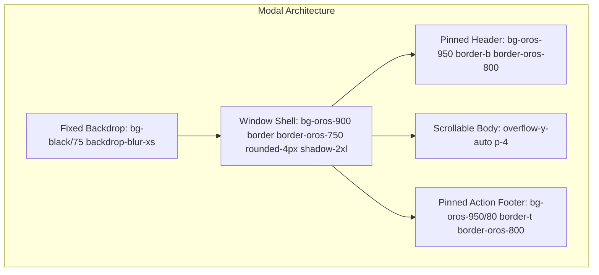

# OROS DESIGN SYSTEM SPECIFICATION (DESIGN.md)
*The Architectural & Tactile Design Guidelines for the Oros Codex Application*

> **Version:** 1.0.0  
> **Status:** Production Standard  
> **Target Aesthetic:** Tactile Archival Craft (Linear, Obsidian, Raycast, Zed)  
> **Strict Anti-Pattern:** Zero "AI Vibecoded" Tropes (No bubbly pills, no gratuitous glow gradients, no washed-out low contrast text).

---

## 1. Core Design Philosophy

Oros is built as a serious, production-grade worldbuilding studio and archival codex. The user interface reflects physical craftsmanship: bookbinding, illuminated manuscripts, precision drafting tools, and architectural blueprints.

### The 4 Tenets of Oros Craft:

1. **Architectural Density & Precision**
   - High information density without visual clutter.
   - Micro-radii (`2px` to `4px`) over amorphous rounded blobs (`rounded-2xl` or `rounded-3xl` are strictly forbidden for buttons and standard cards).
   - Crisp, hairline borders (`1px`) establish clear planar depth and separation.

2. **Tactile Physical Feedback**
   - Interactive elements must feel mechanical and physical: subtle 120ms active scales (`scale(0.97)`), hairline borders that illuminate on hover, and distinct pressed states.
   - Buttons, inputs, and list items have distinct visual affordances so users never doubt what is clickable.

3. **High Contrast & Legibility Over Pure Novelty**
   - Typography must meet or exceed WCAG AA/AAA standards. 
   - No gray-on-gray low-contrast text. In Dark Mode, primary text is crisp slate-white (`#edf0f4`), secondary is cool silver (`#b4bdcd`). In Light Mode, text is high-contrast deep slate (`#0f172a` / `#334155`).
   - Primary action buttons (`.btn-accent`) dynamically enforce inverse high-contrast foreground text (`var(--oros-accent-contrast)`).

4. **Zero-AI Gimmicks & Strict Subtitle Prohibition**
   - **No Redundant AI-Like Subtitles**: Never clutter the interface with patronizing, redundant explanatory subtitles under toggles, toolbar buttons, settings rows, or modals. Standard UX paradigms (e.g., Snapping, Grid, Themes, Zoom, Flex, Arrow Styles, Reverse Direction) are already understood by users.
   - **Icon-First & Clean Labels**: Prefer self-explanatory single labels or clean icon buttons with subtle browser hover tooltips (`title="..."`). Do not add secondary explanatory sentences beneath controls.
   - **Direct, Authoritative Microcopy**: Avoid generic glowing multi-color gradient borders, hyper-saturated neon glows, and patronizing AI-sounding marketing copy (e.g., *"Crafted with mystic synergy"* or *"Curated one-word signature categories"*). Keep microcopy functional, minimal, and precise.

---

## 2. Color Palette & Semantic Tokens

The Oros color system is split into **Neutral Base Layers** and **Atmospheric Accent Tokens**.

### 2.1 Neutral Base Scales

Oros utilizes a custom 13-step neutral scale (`--oros-50` through `--oros-950`).

| Token | Dark Mode RGB / Hex | Light Mode RGB / Hex | Semantic Role |
| :--- | :--- | :--- | :--- |
| `--oros-50` | `248 249 250` (`#f8f9fa`) | `2 6 23` (`#020617`) | Highlight text / Inverted pure |
| `--oros-100` | `237 240 244` (`#edf0f4`) | `15 23 42` (`#0f172a`) | **Primary Text** / Headings |
| `--oros-200` | `215 220 228` (`#d7dce4`) | `30 41 59` (`#1e293b`) | **Body Text** / Labels |
| `--oros-300` | `180 189 205` (`#b4bdcd`) | `51 65 85` (`#334155`) | **Secondary Text** / Metadata |
| `--oros-400` | `135 147 167` (`#8793a7`) | `71 85 105` (`#475569`) | **Muted Text** / Icons / Placeholders |
| `--oros-500` | `96 107 129` (`#606b81`) | `100 116 139` (`#64748b`) | Technical counters / Key hints |
| `--oros-600` | `67 76 94` (`#434c5e`) | `148 163 184` (`#94a3b8`) | Inactive states / Subtle dividers |
| `--oros-700` | `44 51 64` (`#2c3340`) | `203 213 225` (`#cbd5e1`) | Strong borders / Active outlines |
| `--oros-750` | `33 39 50` (`#212732`) | `218 224 233` (`#dae0e9`) | Card borders / Elevated borders |
| `--oros-800` | `27 31 40` (`#1b1f28`) | `226 232 240` (`#e2e8f0`) | **Standard Hairline Border** |
| `--oros-850` | `20 23 31` (`#14171f`) | `241 245 249` (`#f1f5f9`) | Hover backgrounds / Input backgrounds |
| `--oros-900` | `15 17 22` (`#0f1116`) | `255 255 255` (`#ffffff`) | **Surface / Card / Dialog Background** |
| `--oros-950` | `9 10 13` (`#090a0d`) | `248 250 252` (`#f8fafc`) | **Application Viewport / Canvas Deep** |

### 2.2 Atmospheric Accent Tokens

Each World project or user theme assigns an atmospheric accent. The theme engine computes derived tokens:

```css
:root {
  --oros-accent: #e2e8f0;            /* Primary accent color */
  --oros-accent-muted: rgba(...);    /* 12-14% opacity for active chips/tabs */
  --oros-accent-subtle: rgba(...);   /* 4-5% opacity for faint highlights */
  --oros-accent-border: rgba(...);   /* 30-35% opacity for active borders */
  --oros-accent-hover: #ffffff;      /* Lightened/brightened hover color */
  --oros-accent-ring: rgba(...);     /* 25-30% opacity focus rings */
  --oros-accent-glow: rgba(...);     /* 20-25% opacity subtle drop shadows */
  --oros-accent-contrast: #090a0d;   /* WCAG-compliant high-contrast text color */
  --oros-accent-dots: rgba(...);     /* Dotted canvas background dots */
}
```

### 2.3 Semantic Status Palette

- **Success / Affirmation:** Emerald (`#10b981`, badge `bg-emerald-950/60 text-emerald-300 border-emerald-800/80`)
- **Warning / Unsaved:** Amber (`#f59e0b`, badge `bg-amber-950/60 text-amber-300 border-amber-800/80`)
- **Danger / Deletion:** Rose / Red (`#f43f5e`, badge `bg-rose-950/60 text-rose-300 border-rose-800/80`)
- **Information / System:** Cyan (`#06b6d4`, badge `bg-cyan-950/60 text-cyan-300 border-cyan-800/80`)

---

## 3. Typography Matrix

Oros pairs classical literary serifs with sharp, modern sans-serifs and a monospaced technical font.

| Role | Font Family | Default Fallback | Primary Usage |
| :--- | :--- | :--- | :--- |
| **Serif** | Playfair Display / Cinzel / Cormorant | Georgia, serif | Article titles, book titles, blockquotes, codex reader |
| **Sans** | Plus Jakarta Sans / Inter | system-ui, sans-serif | UI labels, sidebar trees, buttons, dialogs, form inputs |
| **Mono** | JetBrains Mono / Fira Code | monospace | Keyboard shortcuts, word counts, dates, IDs, hex codes |

### Type Scale

| Class | Font Size | Line Height | Usage |
| :--- | :--- | :--- | :--- |
| `text-[10px]` | 10px | 1.4 | Badges, keyboard hotkeys, uppercase section headers |
| `text-[11px]` | 11px | 1.4 | Tree view labels, breadcrumbs, table metadata |
| `text-xs` | 12px | 1.5 | Standard button text, input labels, dropdown options |
| `text-sm` | 14px | 1.5 | Card titles, modal headers, standard sidebar headers |
| `text-base` | 16px | 1.6 | Article body text, editor content |
| `text-lg` | 18px | 1.4 | Section headers, drawer titles |
| `text-xl` | 20px | 1.3 | Major modal titles, article subheaders (H2) |
| `text-2xl` | 24px | 1.2 | Article main titles (H1), project directory titles |

---

## 4. Radii, Hairlines, and Spatial Geometry

All elements strictly adhere to the **Oros Geometric Grid**:

```
[2px] Micro-Radius    → Badges, keyboard keycaps, color swatches, tag chips
[3px] Standard-Radius → Buttons, text inputs, selects, dropdown menus, table rows
[4px] Surface-Radius  → Cards, modals, floating panels, toolbars
[0px] Sharp-Radius    → Tab bars, canvas viewports, docked panels
```

### Hairline Rule:
Never use border widths greater than `1px` unless rendering a focused ring or active selection strip:
- Standard container: `border border-oros-800`
- Elevated container: `border border-oros-750`
- Active / Selected item: `border border-accent/50 ring-1 ring-accent/30`

---

## 5. Component Standards

### 5.1 Buttons

```html
<!-- Primary Accent Action Button -->
<button class="btn-accent px-3.5 py-1.5 rounded-[3px] text-xs font-semibold shadow-sm transition-all flex items-center gap-1.5">
  <Icon class="w-3.5 h-3.5" />
  <span>Save Record</span>
</button>

<!-- Secondary Neutral Action Button -->
<button class="px-3 py-1.5 rounded-[3px] text-xs font-medium text-oros-300 hover:text-oros-100 bg-oros-850 hover:bg-oros-800 border border-oros-750 transition-colors">
  Cancel
</button>

<!-- Ghost / Icon Action Button -->
<button class="p-1.5 rounded-[3px] text-oros-400 hover:text-oros-100 hover:bg-oros-850 transition-colors">
  <MoreVertical class="w-3.5 h-3.5" />
</button>

<!-- Destructive Action Button -->
<button class="px-3 py-1.5 rounded-[3px] text-xs font-semibold bg-rose-600 hover:bg-rose-500 text-white border border-rose-500/60 shadow-sm transition-colors">
  Delete
</button>
```

### 5.2 Form Controls & Inputs

```html
<!-- Text Input -->
<input
  type="text"
  class="w-full bg-oros-950 border border-oros-750 rounded-[3px] px-2.5 py-1.5 text-xs text-oros-100 placeholder-oros-500 focus:outline-none focus:border-accent font-sans transition-all"
  placeholder="Enter title..."
/>

<!-- Field Label -->
<label class="block text-[10px] font-mono uppercase text-oros-400 font-bold tracking-wider mb-1">
  Field Title <span class="text-rose-400">*</span>
</label>
```

### 5.3 Modals & Floating Dialogs

Every modal in Oros MUST follow this triple-container structure:
1. **Backdrop**: Fixed overlay with `bg-black/75 backdrop-blur-xs flex items-center justify-center p-3 sm:p-4 z-50`.
2. **Window Shell**: Centered frame with `bg-oros-900 border border-oros-750 rounded-[4px] shadow-2xl flex flex-col max-h-[90vh] overflow-hidden`.
3. **Pinned Header**: `px-4 py-3 border-b border-oros-800 bg-oros-950 shrink-0 flex items-center justify-between`.
4. **Scrollable Body**: `p-4 space-y-4 overflow-y-auto flex-1`.
5. **Pinned Footer**: `px-4 py-3 border-t border-oros-800 bg-oros-950/80 shrink-0 flex items-center justify-end gap-2`.



### 5.4 Graph Visualizers & Whiteboard Canvases

- **Dotted Background Grid**: All graph visualizers (Card Relations, Whiteboard, Timeline, Lineage) use `var(--oros-accent-dots)`:
  ```css
  .oros-dotted-surface {
    background-image: radial-gradient(circle, var(--oros-accent-dots) 1.25px, transparent 1.25px);
    background-size: 24px 24px;
  }
  ```
- **Connection Edges**: Edge arrows and lines dynamically inherit `--oros-accent`.

### 5.5 Microcopy & Subtitle Elimination (Strict Prohibition of AI-Style Helper Text)

A core identity principle of Oros is the absolute elimination of redundant, patronizing, "AI-generated" helper text and subtitles:

```
[STRICT RULE]
No explanatory subtitles beneath standard features, toggles, toolbars, or settings.
If a control can be represented via an icon or a single concise label, that is always preferred.
```

#### Detailed Guidelines:
1. **Toolbars & Visualizer Controls (Whiteboard, Cartography, Relations, Timeline)**:
   - **Icon-First**: Tools must prefer clean, tactile icon buttons with standard browser hover tooltips (`title="Snap to Grid"`) rather than text labels with multi-line explanatory captions.
   - **Zero Patronizing Explanations**: Never write subtitles explaining what standard controls do (e.g. *do NOT* write *"Snapping: Automatically aligns nodes to grid intervals"* or *"Reverse Direction: Swaps the start and end anchors"*). Users already understand standard computer graphics tools.
   - **In-Canvas Context Tooltips**: When interacting with arrows, relations, or shapes, show compact floating toolbars for thickness, style, flex, and color without educational paragraphs.

2. **Settings Rows & Dialogs**:
   - Keep settings rows clean: Title on the left, control on the right (e.g., `Theme` + dropdown selector).
   - Never add filler subtitles such as *"Personalize your workspace aesthetic with curated color palettes"*.
   - Never use AI-sounding marketing copy or comparisons to other software.

3. **Comparison Matrix**:

| Feature / Control | ❌ Forbidden (AI Subtitle / Bloat) | ✅ Required (Oros Standard) |
| :--- | :--- | :--- |
| **Grid Snapping** | Toggle labeled "Snapping" with subtitle: *"Snap nodes and items to the nearest grid intersection for precise alignment"* | Clean Magnet icon button with `title="Snap to Grid (S)"` |
| **Edge Flex** | Slider with subtitle: *"Adjust the curvature and bendiness of connection lines between cards"* | Icon or compact slider labeled `"Flex"` |
| **Theme Selection** | Heading "Theme" with subtitle: *"Select from an array of atmospheric dark and light themes crafted for worldbuilding"* | Section title `"Theme"`, followed immediately by the theme selector grid |
| **Export Action** | Button with subtitle: *"Export high-resolution raster and vector graphics to disk"* | Dropdown button `"Export"` with items `PNG (2x)`, `SVG`, `JSON`, `CSV` |

---

## 6. Theme Configuration System

Oros provides an extensible styling engine for custom themes.

### 6.1 Theme JSON Configuration Schema (`ThemeConfig`)

A Theme Config file (`oros-theme.json`) defines semantic tokens and optional custom CSS:

```json
{
  "id": "nord-frost",
  "name": "Nordic Frost",
  "version": "1.0.0",
  "author": "Oros Team",
  "description": "An arctic, cool-bluish palette with crisp icy accents.",
  "colorMode": "dark",
  "tokens": {
    "accent": "#88c0d0",
    "muted": "rgba(136, 192, 208, 0.14)",
    "subtle": "rgba(136, 192, 208, 0.05)",
    "border": "rgba(136, 192, 208, 0.35)",
    "hover": "#a3be8c",
    "ring": "rgba(136, 192, 208, 0.30)",
    "glow": "rgba(136, 192, 208, 0.25)",
    "contrast": "#2e3440",
    "dots": "rgba(136, 192, 208, 0.35)"
  },
  "customCss": "/* Optional custom theme-level CSS overrides */\n.oros-wiki-prose h1 { border-color: #88c0d0; }"
}
```

### 6.2 Dual-Scope Resolution Hierarchy

Styling resolves in a strict cascade:

```
[1. Global App Defaults]
        ↓
[2. Active Global Theme Config]
        ↓
[3. Workspace / Vault Specific Theme Override] (Saved inside World archive)
```

- **Global Scope**: Applies across all projects, project directory, and settings.
- **Workspace Scope**: Saved in the world's project metadata (`world.themeConfig`), traveling seamlessly with `.oros.json` archives.

---

## 7. Quality Assurance & Review Checklist

Before committing any UI change, verify:
- [ ] Are button and card radii set to `rounded-[2px]`, `rounded-[3px]`, or `rounded-[4px]`? (No `rounded-2xl`/`3xl`).
- [ ] Is text contrast verified in both Dark Mode (`data-color-mode="dark"`) and Light Mode (`data-color-mode="light"`)?
- [ ] Are modal footers pinned and guaranteed visible on 768px height viewports?
- [ ] Does the accent color dynamically adapt when the user changes the world theme?
- [ ] **Are all controls, toggles, toolbars, and settings free of redundant AI-like explanatory subtitles?**
- [ ] **Do visualizer toolbars prefer clean icons with native browser tooltips (`title="..."`) over explanatory subtitles?**
- [ ] **Are labels direct and functional without patronizing tutorial copy?**
