# Oros

<p align="center">
  <picture>
    <source media="(prefers-color-scheme: dark)" srcset="showcase-assets/logos/oroslogo-full-white.svg">
    
  </picture>
</p>

<p align="center">
  <strong>An offline desktop workspace for worldbuilding, lore architecture, and novel drafting.</strong>
</p>

<p align="center">
  <strong>https://oros.lacrisunny.workers.dev/</strong>
</p>


<p align="center">
  <a href="https://github.com/gpwid/oros/releases/latest"></a>
  <a href="https://github.com/gpwid/oros/releases"></a>
  <a href="https://github.com/gpwid/oros/blob/main/LICENSE"></a>
  <a href="https://github.com/gpwid/oros"></a>
  <a href="https://github.com/gpwid/oros"></a>
</p>

---

<p align="center">
  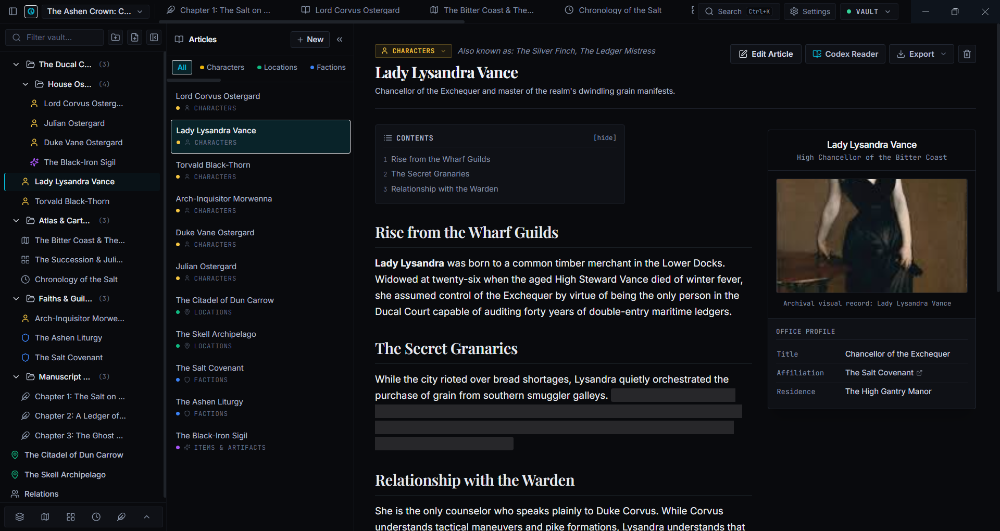
</p>

Oros is a private, local-first desktop application designed for fantasy and science fiction authors, tabletop Game Masters, screenwriters, and lore architects. It unites spatial visual planning, relational knowledge graphs, encyclopedia documentation, cartography, timelines, and manuscript composition into a unified workspace.

All project data is stored on your local drive in human-readable files. There are no user accounts, no telemetry, no cloud dependencies, and no subscription paywalls.

---

## Core Philosophy

* **100% Data Sovereignty**: Your world data belongs to you. Every project lives as a directory on your machine. Projects can be backed up with standard backup tools, versioned via Git, or exported into open formats at any time.
* **Unified Lore & Manuscript**: Writing fiction and documenting lore should not happen in separate apps. Oros allows you to reference, query, and verify canon while writing your manuscript without context-switching.
* **Tactile Archival Craft**: Built with an emphasis on high information density, clear contrast, fast keyboard navigation, and physical desktop aesthetics.

---

## Modules

### 1. Canvas (Visual War Table)
An infinite spatial planning board combining entity cards, Markdown notes, freehand ink, and directional connectors.

* Link character, faction, and location cards directly from your vault.
* Use orthogonal step routing, dotted lines, custom line colors, and inline connector labels.
* Group ideas into labeled regions, add sticky notes, and sketch diagrams with vector ink.
* Navigate large boards with a corner minimap, customizable grid snapping, and image export.

<p align="center">
  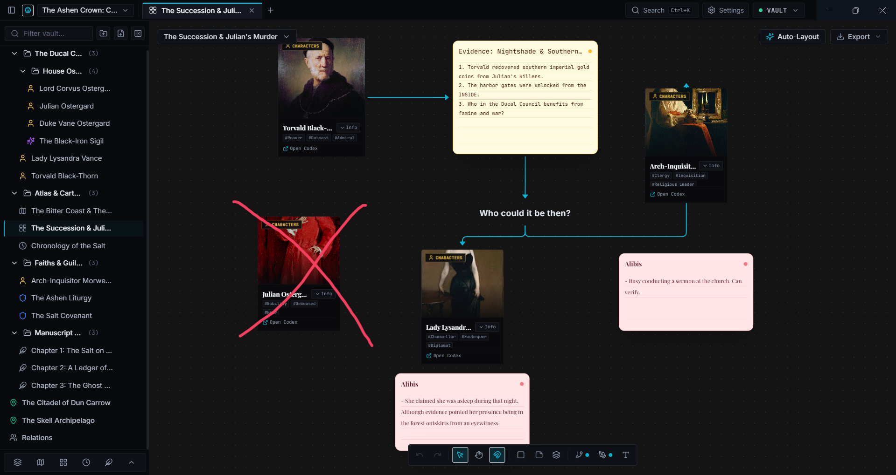
</p>

---

### 2. Relations (Heraldic Network Graph)
An interactive relational graph designed to map family lineages, feudal allegiances, political treaties, and vendettas.

* Render directed relationship vectors with customizable labels (e.g., *Sworn Vassal*, *Blood Rival*, *Heir Apparent*).
* Filter nodes by category (Characters, Houses, Factions, Guilds) to isolate specific conflict webs.
* Dynamic node arrangement with per-world layout persistence.

<p align="center">
  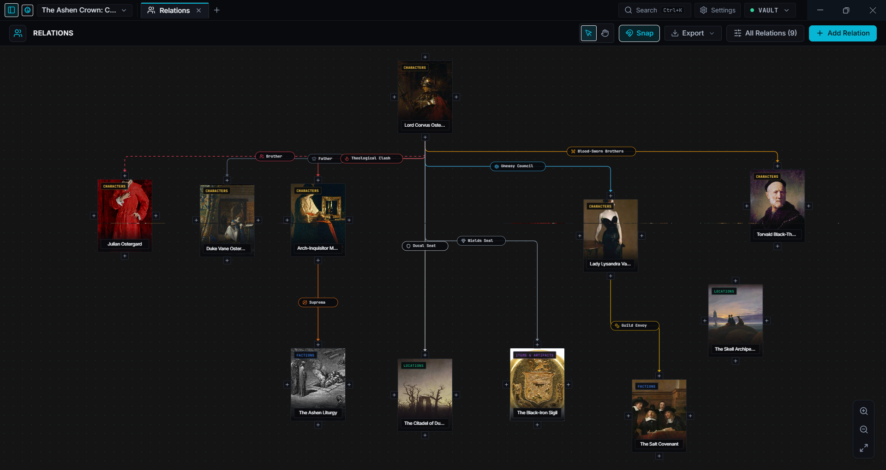
</p>

---

### 3. Writer (Manuscript Editor)
A distraction-free manuscript editor that seamlessly bridges creative prose with your world's underlying canon.

* Structured project tree organizing Acts, Volumes, Chapters, and Scenes with word count tracking.
* Type `[[` to trigger instant autocomplete for any entity in your vault; hovering previews its lore card inline.
* Rename any lore entry once to automatically update bidirectional `[[wiki-link]]` references throughout your prose.
* Press `F11` for full-screen focus mode with muted chrome and custom typographic settings.

<p align="center">
  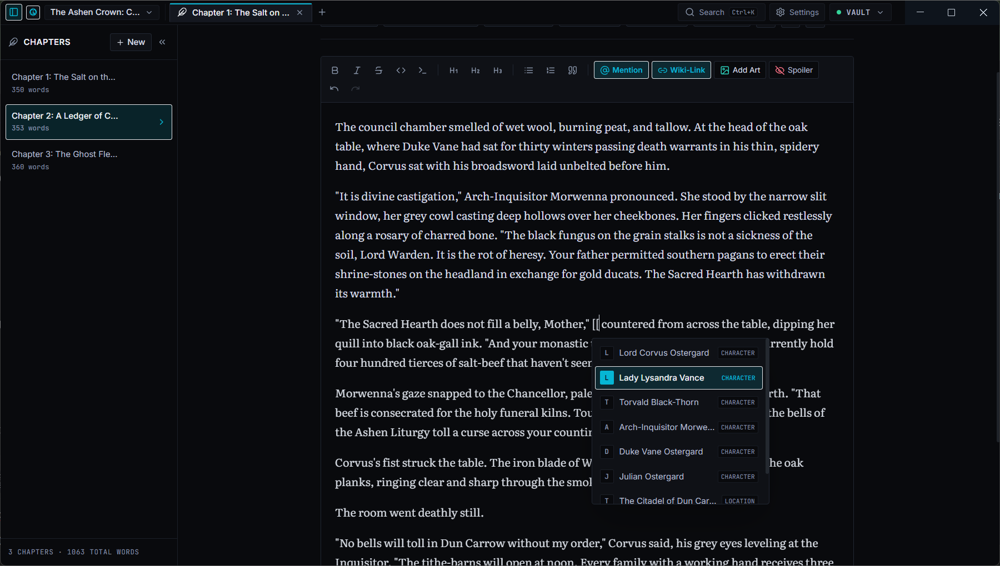
</p>

---

### 4. Wiki (Encyclopedia & Infoboxes)
A structured documentation system for deep worldbuilding records across characters, factions, settlements, magic systems, and relics.

* MediaWiki-inspired layout featuring structured side-infoboxes with portraits, genealogical links, and custom attributes.
* Automatic bidirectional backlinks ("What Links Here") tracking every reference across chapters, maps, and canvas boards.
* Instant toggle between interactive rich-text editing and clean encyclopedia reader view.

<p align="center">
  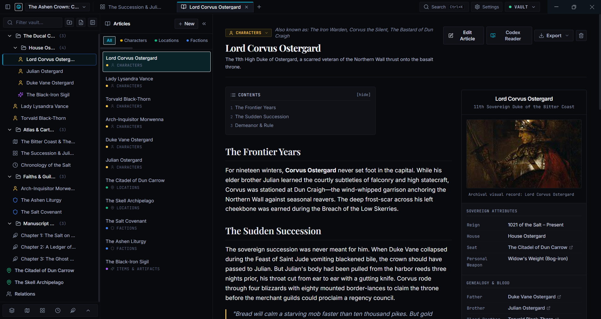
</p>

---

### 5. Map (Deep-Zoom Cartography)
A dedicated cartography viewer supporting raster maps, coordinate-linked markers, and geopolitical territory borders.

* Deep-zoom panning and navigation for high-resolution fantasy and sci-fi world maps.
* Pin landmarks, fortresses, and points of interest linked directly to wiki articles or nested regional sub-maps.
* Vector polygon drawing tools for demarcating kingdoms, provinces, and disputed territories.
* Interactive distance ruler supporting configurable units (Miles, Leagues, Kilometers, Hexes).

<p align="center">
  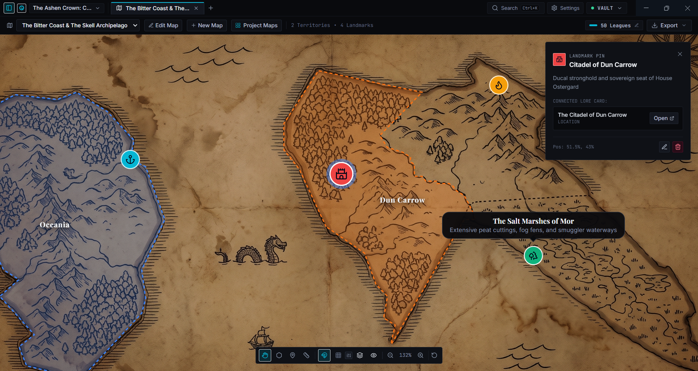
</p>

---

### 6. Search & Command Palette (`Ctrl+K`)
A sub-millisecond search and execution palette accessible from anywhere in the application.

* Universal search querying article titles, aliases, infobox values, and manuscript prose simultaneously.
* Prefix filters for rapid targeting: `#` for tags, `@` for locations, `!` for maps and canvas boards.
* Keyboard-driven command execution for creating entities, switching views, and adjusting settings.

<p align="center">
  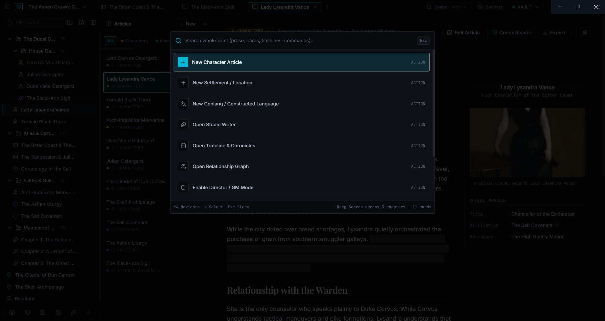
</p>

---

### 7. Timeline (Multi-Era Chronology)
A zoomable temporal ruler for documenting epochs, historic eras, and dated chronicle events.

* Multi-tier significance tagging (Mythic, Major, Minor) with direct entity cross-referencing.
* Custom fantasy calendar configuration supporting non-standard month counts, intercalary festival days, and lunar alignments.
* Span multi-year historical eras alongside discrete pinpoint events on the same axis.

<p align="center">
  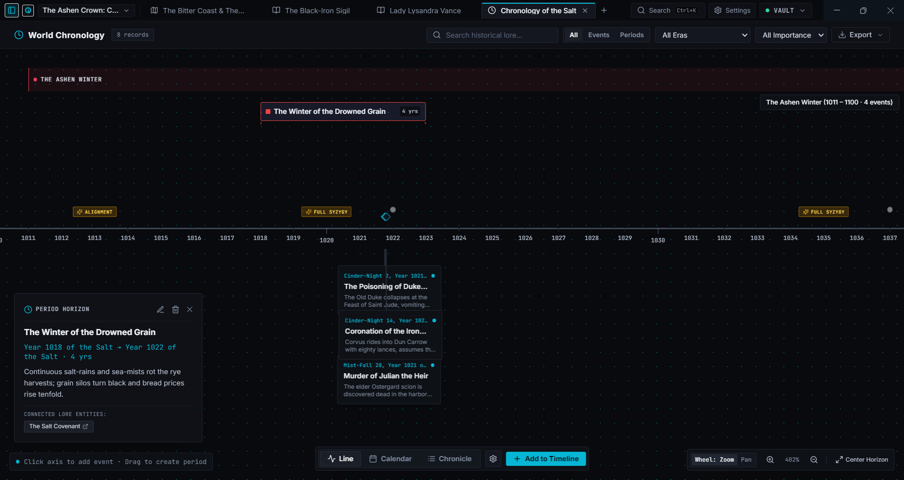
</p>

---

### 8. Themes & Workspace Customization
Granular visual controls separating project aesthetic identity from desktop workspace preferences.

* **Project Themes**: Set custom cover banners, genre presets (Fantasy, Sci-Fi, Grimdark, Cyberpunk, Solarpunk, etc.), and custom accent hex codes per world.
* **Workspace Themes**: Switch between Dark Obsidian and high-contrast Light mode based on writing conditions.

<p align="center">
  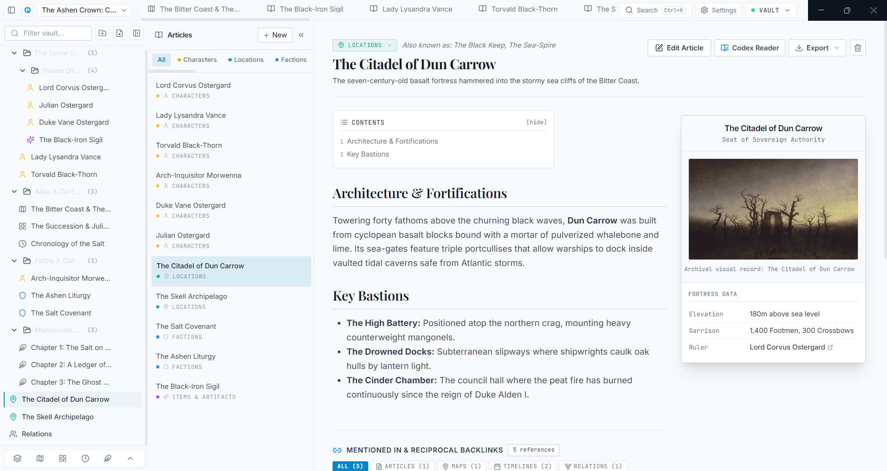
</p>
<p align="center">
  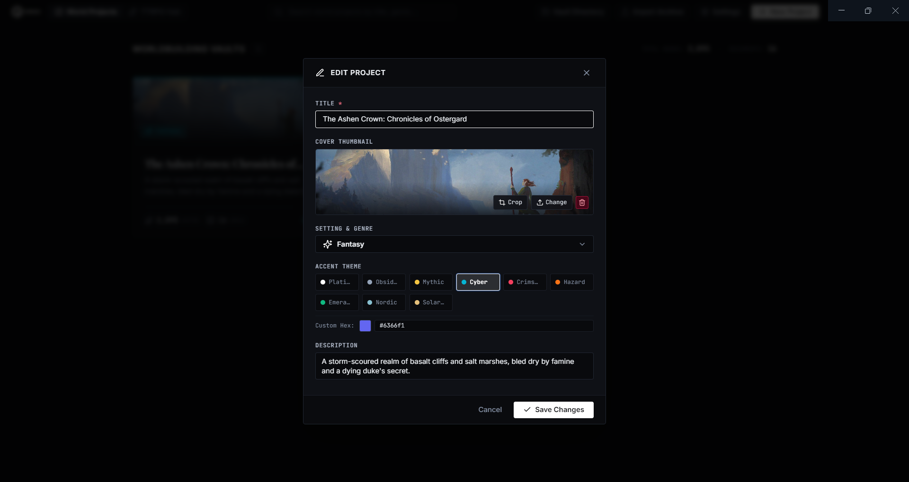
</p>
---

### 9. Codex (Reader & Print Compendium)
A clean, book-like reading interface for reviewing finished manuscript chapters and lore articles.

* Classical book typography options including Garamond, Literata, and Sans-Serif with adjustable line height and column widths.
* Unified navigation index combining story manuscripts and encyclopedia lore into a coherent digital bible.
* Print-ready stylesheet and export pipeline for physical binders and reading copies.

<p align="center">
  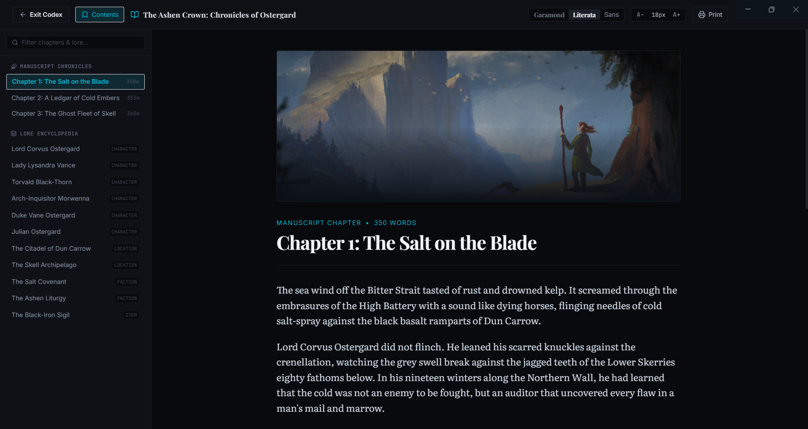
</p>

---

### Other Tools
* **Conlang Studio**: Design fictional languages with phonetic inventory rules, syllable generators, and custom dictionary lexicons.
* **Obsidian Vault Interop**: Export articles and chapters as standard Markdown notes formatted with YAML frontmatter.
* **Vault Snapshots & Backups**: One-click local backup archive (`.oros.json`) generation for safe offline storage and migration.

---

## Getting Started

### Pre-Built Binaries
Executable releases for **Windows 64-bit** (installer `.exe` and portable `.zip`) are available directly from the [GitHub Releases](https://github.com/gpwid/oros/releases) page.

### Building from Source

#### Prerequisites
* [Node.js](https://nodejs.org/) (v20+ or v22+ LTS)
* [pnpm](https://pnpm.io/) (v9+)

#### 1. Clone & Install
```bash
git clone https://github.com/gpwid/oros.git
cd oros
pnpm install
```

#### 2. Run Desktop Development Server
```bash
pnpm dev
```

#### 3. Package Standalone Binary
```bash
# Build production bundle
pnpm build

# Package Windows desktop executable
pnpm run package
```
Packaged binaries will be created in `release/Oros-win32-x64/` with portable archives placed in `release/`.

---

## Tech Stack

| Layer | Technology | Purpose |
| :--- | :--- | :--- |
| **Desktop Shell** | Electron 34 | Offline desktop runtime, window management, and native filesystem IPC |
| **Frontend Framework** | React 18 & TypeScript 5 | Type-safe declarative user interface |
| **Build Tool** | Vite 6 | Fast HMR development and optimized production bundling |
| **Styling** | Tailwind CSS 4 | Precise design system tokens, CSS variables, and layout density |
| **Prose Engine** | TipTap 2 (ProseMirror) | Rich-text editing, bidirectional `[[wiki-links]]`, and infobox embeddings |
| **Node Graph** | XYFlow (React Flow 12) | Hardware-accelerated infinite canvas and relationship vectors |
| **State Management** | Zustand 5 | Modular, reactive state stores with desktop persistence |
| **Data Format** | Local JSON & Markdown | User-owned, Git-friendly vault structure on your local filesystem |

---

## Data Structure & Portability

Oros vaults are stored as clean directory hierarchies on your drive:

```text
MyWorld/
├── world.json          # Project metadata, genre presets, and theme configuration
├── entities/           # Encyclopedia records (Characters, Factions, Relics, Locations)
├── relations/          # Relationship graphs and coordinate positions
├── canvas/             # Spatial boards, sticky notes, and freehand vector paths
├── maps/               # Raster image maps, pins, and territory polygon boundaries
├── manuscript/         # Chapters, acts, and scene prose
└── timelines/          # Era configurations, historical events, and custom calendars
```

Because your files are standard JSON and Markdown, you are never locked into proprietary binary blobs. You can inspect, version control, or script transformations against your vault using standard tooling.

---

## Contributing

Contributions, bug reports, and feature proposals are welcome:

1. Fork the repository on [GitHub](https://github.com/gpwid/oros).
2. Create a feature branch (`git checkout -b feature/new-module`).
3. Commit your changes adhering to existing architectural standards.
4. Open a Pull Request with a clear description of changes.

---

## License

Distributed under the **MIT License**. Free to use, modify, distribute, and own.

Created and maintained by [gpwid](https://github.com/gpwid).
